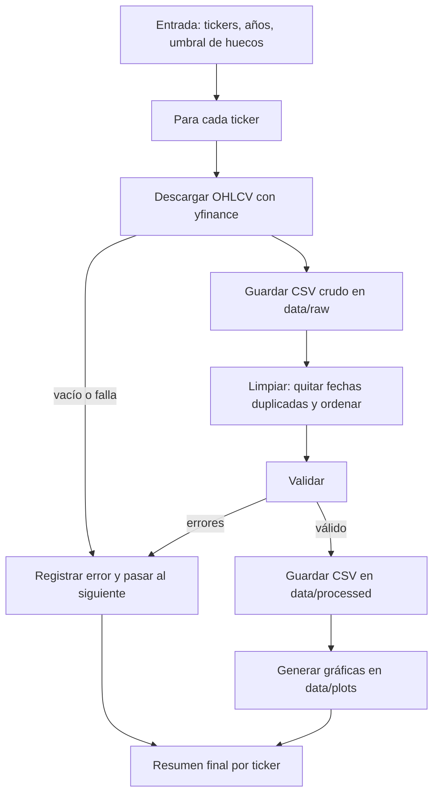

# Pipeline de datos históricos de precios

Pipeline en Python que descarga precios históricos de acciones y criptomonedas, los **limpia, valida y reporta**, y guarda solo los datos que pasan la validación. Es la base de datos "confiable" sobre la que se construyen los siguientes proyectos de mi roadmap de trading cuantitativo (backtesting, pricing de opciones, optimización de portafolio).

> **Idea central:** nunca construir un modelo sobre datos que no he verificado. Un backtester alimentado con datos defectuosos produce resultados falsos con total confianza.


---

## Qué hace

1. Pide uno o varios tickers (`AAPL, NVDA, BTC-USD`), el número de años y el umbral de días para detectar huecos.
2. Descarga los datos OHLCV de cada ticker por separado con `yfinance`.
3. Guarda los datos **crudos** sin tocarlos.
4. Elimina fechas duplicadas y ordena cronológicamente.
5. Valida los datos con reglas de consistencia (errores) y revisiones de calidad (advertencias).
6. Si el ticker es válido, guarda el CSV **procesado** y genera dos gráficas.
7. Muestra una tabla resumen con el estado de cada ticker.

Cada ticker viaja por el pipeline de forma independiente: si uno falla (ticker inexistente, datos con errores, excepción inesperada), los demás continúan.

---

## Flujo del pipeline



---

## Estructura del proyecto

```
QF_proyecto-1/
├── data/                      # generado al ejecutar (no se versiona)
│   ├── raw/                   # datos tal como los entrega la API
│   ├── processed/             # datos limpios que pasaron la validación
│   └── plots/                 # gráficas en PNG
├── docs/
│   └── images/                # capturas para este README
├── python/
│   ├── config.py              # rutas del proyecto, definidas en un solo lugar
│   ├── fetch.py               # descarga y guardado de CSV
│   ├── validate.py            # limpieza, validación y chequeo de huecos
│   ├── plot.py                # gráfica de cierre y de velas
│   ├── main.py                # punto de entrada y orquestación
│   └── tests/
│       └── test_validate.py   # pruebas con datos sembrados
├── environment.yml
├── pytest.ini
└── README.md
```

Cada módulo tiene una sola responsabilidad: descargar, validar y graficar no dependen unos de otros, así que se pueden probar y reutilizar por separado.

---

## Instalación

Requiere [conda](https://docs.conda.io/en/latest/miniconda.html) (Miniconda es suficiente).

```bash
conda env create -f environment.yml
conda activate quant
```

Dependencias principales: `pandas`, `yfinance`, `matplotlib`, `mplfinance` y `pytest`.

## Uso

Desde la carpeta `python/`:

```bash
python main.py
```

El programa pregunta:

| Pregunta | Ejemplo | Por defecto |
|---|---|---|
| Símbolos separados por comas | `AAPL, NVDA, BTC-USD` | — |
| Años de datos a obtener | `3` | 1 |
| Umbral de días sin datos para marcar un hueco | `4` | 4 |

Los símbolos se normalizan a mayúsculas, y los vacíos y duplicados se descartan. Se respetan guiones y puntos (`BTC-USD`, `BRK-B`, `WALMEX.MX`).

### Archivos generados

| Archivo | Contenido |
|---|---|
| `data/raw/<TICKER>_data_raw.csv` | Datos crudos de la API (se guardan siempre) |
| `data/processed/<TICKER>_data_processed.csv` | Datos limpios (solo si pasan la validación) |
| `data/plots/<TICKER>_chart.png` | Precio de cierre ajustado en el tiempo |
| `data/plots/<TICKER>_candle.png` | Velas japonesas con volumen y medias móviles (últimos 251 días) |

---


---


---

## Qué valida y por qué

La validación **reporta, no corrige**. Separa los hallazgos en dos categorías según su gravedad.

### Errores (bloquean el guardado de datos procesados)

Son condiciones que un precio real nunca cumple, así que indican datos corruptos.

| Regla | Por qué es un error |
|---|---|
| Precio de cierre ≤ 0 | Los precios deben ser positivos |
| Precio de cierre ajustado ≤ 0 | Idem, sobre la serie ajustada |
| Volumen negativo | Imposible |
| High menor que Low | El máximo del día no puede ser menor al mínimo |
| High menor que Open o Close | El máximo debe ser el mayor del día |
| Low mayor que Open o Close | El mínimo debe ser el menor del día |
| Valores nulos | Cualquier `NaN` rompe cálculos posteriores |

### Advertencias (se reportan, no bloquean)

Son situaciones que pueden ser legítimas, así que requieren criterio humano.

| Revisión | Por qué es solo una advertencia |
|---|---|
| Salto diario > 20 % (sobre `Adj Close`) | Puede ser un error de la API, pero también un evento real (resultados trimestrales, noticia) |
| Hueco de más de N días entre fechas consecutivas | Puede ser un cierre excepcional del mercado o datos faltantes |

Los fines de semana (3 días entre viernes y lunes) no cuentan como hueco con el umbral por defecto.

### Limpieza previa a la validación

`clean_data` elimina fechas duplicadas (conserva la última copia, que suele ser la más actualizada) y ordena el índice cronológicamente. Se ejecuta **antes** de validar, porque las fechas duplicadas distorsionan el cálculo de retornos.

---

## Decisiones de diseño

- **`Adj Close` para medir saltos.** `Close` no está ajustado por splits: un split 10:1 (como el de NVDA en junio de 2024) se vería como una caída de -90 % que nunca ocurrió para quien mantuvo la acción. Por eso la advertencia de saltos y la gráfica de línea usan `Adj Close`. Las reglas de consistencia High/Low/Open/Close sí usan columnas sin ajustar, porque están en la misma escala entre sí.
- **El crudo nunca se modifica.** Se guarda antes de limpiar, para poder auditar qué entregó la API y volver a procesar con otro criterio sin descargar de nuevo.
- **Errores bloqueantes vs. advertencias.** Un salto del 20 % puede ser un evento real; borrarlo automáticamente falsearía los datos. Se reporta y la decisión queda en manos de quien analiza.
- **Descarga ticker por ticker.** `yfinance` permite descargar una lista completa, pero devuelve columnas combinadas (MultiIndex) y mezcla calendarios distintos (cripto cotiza fines de semana, las acciones no). Procesarlos por separado mantiene el formato simple y aísla los fallos.
- **Cada fallo tiene el mismo formato que un éxito.** Un ticker que falla devuelve un resultado con la misma estructura, así que el resumen recorre todos sin casos especiales.
- **Rutas definidas una sola vez** en `config.py`, calculadas a partir de la ubicación del archivo, para que el proyecto funcione igual desde cualquier carpeta o computadora.

---

## Pruebas

Las pruebas verifican que el validador **detecte** los errores, no solo que acepte datos buenos. Un validador que siempre dice "todo bien" pasaría pruebas con datos reales sin que nadie se entere.

Desde la raíz del proyecto:

```bash
pytest -v
```

| Prueba | Qué comprueba |
|---|---|
| DataFrame vacío | Se reporta como inválido |
| DataFrame válido | Sin errores ni advertencias, incluyendo que un fin de semana normal no se marque como hueco |
| DataFrame con errores sembrados | Cada regla se activa con el conteo exacto de filas, incluyendo efectos en cascada |

---

## Limitaciones conocidas

- **El umbral de huecos es único para todos los tickers.** Las criptomonedas cotizan todos los días, así que con un umbral de 4 no se detectan huecos de 2 a 4 días. Para cripto conviene usar un umbral de 1.
- **No se usa un calendario real de bolsa.** Los festivos de cada mercado difieren (por ejemplo, acciones mexicanas vs. estadounidenses) y pueden generar falsas alarmas. Una mejora posible es `exchange_calendars` o `pandas_market_calendars`.
- **Las velas usan `Close` sin ajustar.** En ventanas recientes lejos de un split no se nota, pero cerca de uno aparecerá el salto.
- **Fuente de datos.** `yfinance` consume datos públicos de Yahoo Finance, sin garantía de exactitud ni disponibilidad. Es adecuado para aprendizaje y prototipos, no para operar con dinero real.
- **Solo datos diarios.** No hay soporte para datos intradía.

---

## Próximos pasos

- [ ] Backtester de cruce de medias móviles sobre `data/processed/` (señal, ejecución simulada, Sharpe y drawdown)
- [ ] Simulador Monte Carlo para pricing de opciones en C++ (incluye `struct OHLCV` y lector del CSV procesado)
- [ ] Umbral de huecos según tipo de activo
- [ ] Pruebas adicionales: `clean_data` y columnas faltantes

---

## Aviso

Proyecto con fines educativos. Nada de lo contenido aquí constituye asesoría financiera.

**Autor:** Hector Emiliano Garcia Luevano · [EmiGarcia377](https://github.com/EmiGarcia377)
